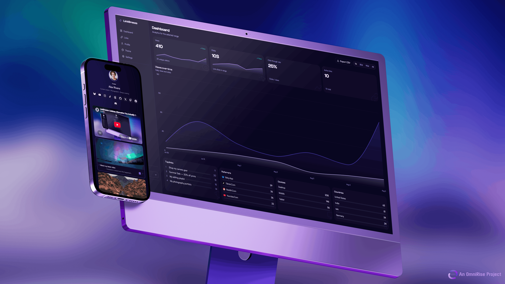
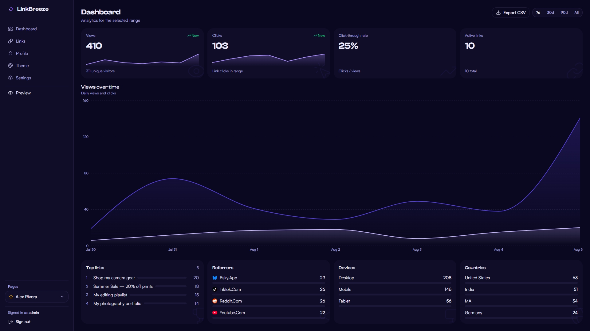
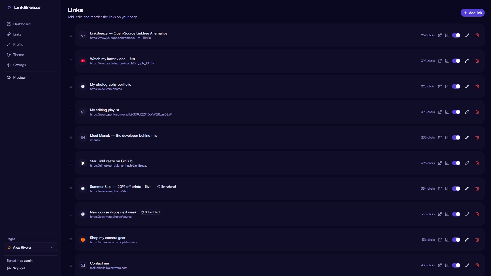
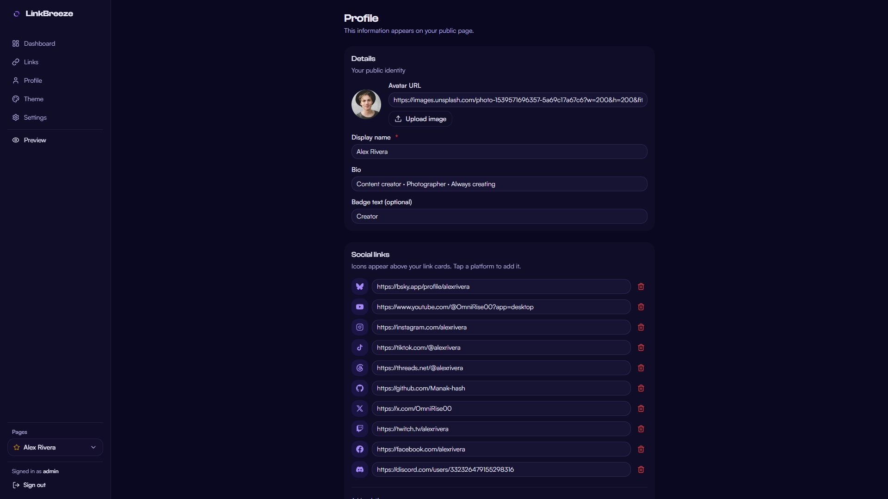
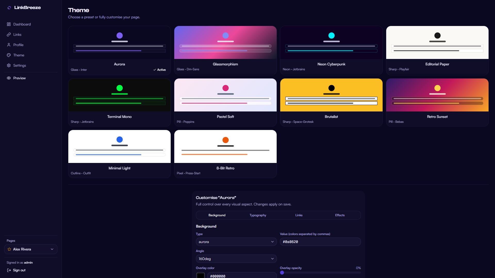
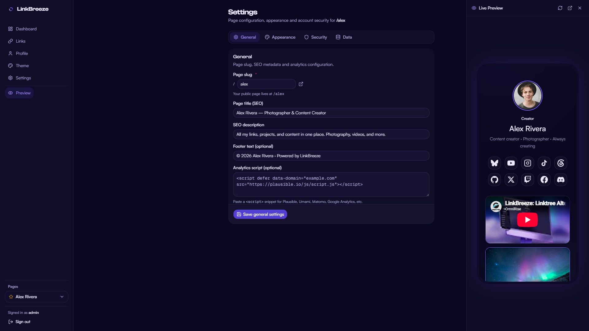
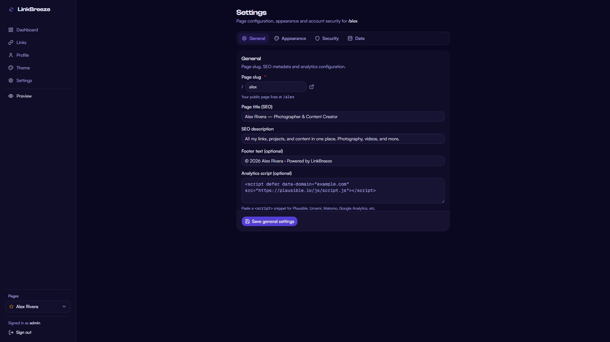
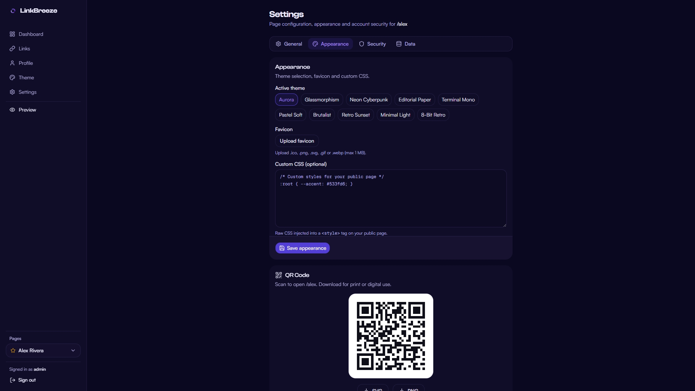
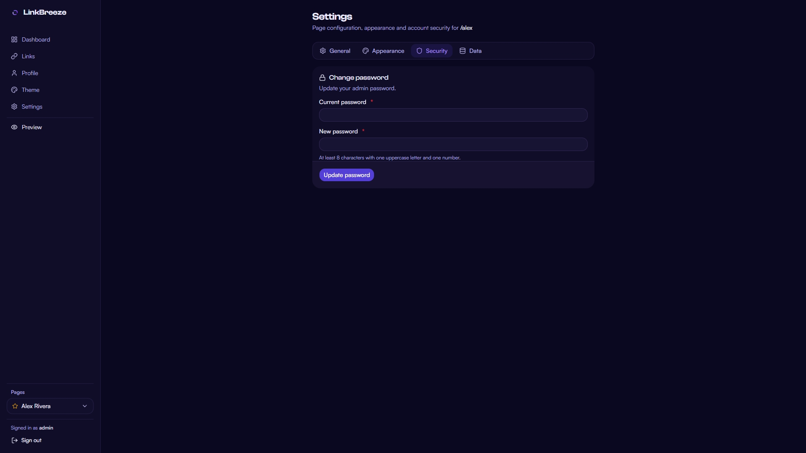
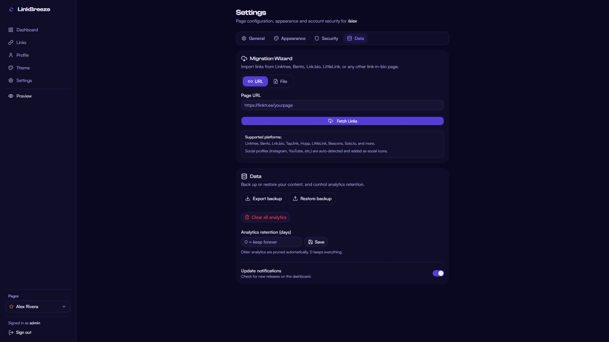

<div align="center">



---

**English** · [Español](README.es.md) · [Français](README.fr.md) · [Deutsch](README.de.md) · [中文](README.zh.md) · [العربية](README.ar.md) · [Português (Brasil)](README.pt-BR.md)

[](LICENSE)
[](https://hub.docker.com/r/omnirise/linkbreeze)

[](https://linkbreeze.omnirise.dev/)
[](https://omnirise.dev)
[](https://www.youtube.com/watch?v=_Ipf-_1B4BY)

[](https://github.com/Manak-hash/LinkBreeze/actions/workflows/ci.yml)
[](https://github.com/Manak-hash/LinkBreeze/releases/latest)
[](https://discord.gg/bAJMW3bAJa)

</div>

---

> **Stop paying $15/mo for Linktree.**  LinkBreeze is a free, self-hosted link hub: fast, customizable, with built-in analytics. **Install in one command.**

<div align="center">

&nbsp;[**🔗 Live Demo**](https://linkbreeze-demo.omnirise.dev/linkbreeze)&nbsp;&nbsp;·&nbsp;&nbsp;
[**🔐 Demo Dashboard**](https://linkbreeze-demo.omnirise.dev/dashboard)

</div>

---

## ✨ Features

<div align="center">
<table>
  <tr>
    <td width="50%" valign="top">🔗 <strong>Multi-Page Support</strong><br/>Unlimited pages, each with its own slug, theme, links and analytics</td>
    <td valign="top">🎨 <strong>Themes + Customizer</strong><br/>11 presets plus a full token-based customizer with import/export</td>
  </tr>
  <tr>
    <td valign="top">📊 <strong>Privacy-first Analytics</strong><br/>Views, clicks, referrers, devices. Cookieless, IPs hashed, auto-pruned</td>
    <td valign="top">🧭 <strong>Migration Wizard</strong><br/>Import from Linktree, Bento, Hopp.bio, LittleLink or any HTML/JSON export</td>
  </tr>
  <tr>
    <td valign="top">🔒 <strong>Self-Hosted</strong><br/>Your data, your server. No trackers, no ads, no subscription</td>
    <td valign="top">🐳 <strong>One-Command Install</strong><br/>One curl command. Auto-detects Docker or Podman and you are live</td>
  </tr>
  <tr>
    <td valign="top">📱 <strong>Embed Widgets</strong><br/>YouTube, Spotify, SoundCloud, Vimeo and Bandcamp on your page</td>
    <td valign="top">🎯 <strong>QR Codes</strong><br/>Auto-generated, custom colors, avatar or favicon center, SVG/PNG up to 1024px</td>
  </tr>
  <tr>
    <td width="50%" valign="top">🌐 <strong>Custom Domains</strong><br/>Bind your own domains to pages — visitors land on jane.com, no /slug</td>
    <td valign="top">⏰ <strong>Scheduled Backups</strong><br/>Daily/weekly/monthly app-internal backups with one-click restore, no cron needed</td>
  </tr>
</table>


⚡ **Zero client-side JavaScript. Loads in under 300ms. Pure server-rendered HTML.**

</div>

<details>
<summary>✨ &nbsp;All features</summary>

- **🔗 Link Management** - Add, reorder and customize unlimited links with drag-and-drop
- **🌐 Auto-Favicon Links** - Links automatically show the target site's favicon, no icon uploads needed
- **🖼️ Link Thumbnails** - Add images to your links for visual preview cards
- **⏰ Link Scheduling** - Schedule links to appear or disappear automatically with date/time controls
- **🏷️ Custom Redirect Slugs** - Stable, shareable `/go/your-name` short links that survive delete-and-recreate
- **📈 External Analytics** - Inject Plausible, Umami, Matomo or Google Analytics with one paste
- **🖼️ Social Preview (OG) Images** - Share cards auto-rendered from your page's theme, or upload your own with fit, position and zoom control
- **✏️ Custom CSS** - Fine-tune your page with raw CSS injection
- **📧 Email Capture** - Collect subscriber emails on your public page, export to CSV
- **🔔 Update Notifications** - Dashboard banner when a new version is available. No phone-home, no auto-update
- **🔑 Fast Admin Panel** - Everything above from one clean, instant dashboard

- **🌐 Custom Domains** - Bind your own domains to pages; exclusive or hub scope, automatic canonical redirects, strict admin host lock
- **⏰ Scheduled Backups** - Daily/weekly/monthly app-internal backups with retention and one-click restore, no cron required
</details>

## 🚀 Quick Start

**One command. Zero config. Live in 30 seconds:**

```bash
curl -fsSL https://linkbreeze.omnirise.dev/install.sh | bash
```

The script detects Docker or Podman, pulls the image and starts the container. Run it with `sudo bash` and answer **y** to also enable auto-start on boot.

Then open **http://localhost:3000** - the setup wizard takes under 30 seconds.

<details>
<summary>🔍 &nbsp;Want to inspect the script before running it?</summary>

```bash
curl -fsSL https://linkbreeze.omnirise.dev/install.sh -o install.sh
less install.sh
bash install.sh
```

</details>

**Prefer a different method?** Expand one below.

<details>
<summary>🐳 &nbsp;Docker</summary>

No Node.js, no npm, no config files. Multi-arch images: `linux/amd64` and `linux/arm64` (Raspberry Pi 3/4/5, Apple Silicon, ARM VPS).

**Linux / macOS / Windows CMD:**

```bash
docker run -d --name linkbreeze --restart unless-stopped -p 3000:3000 -v linkbreeze-data:/app/data docker.io/omnirise/linkbreeze:latest
```

**Windows PowerShell** - use backticks for line breaks:

```powershell
docker run -d `
  --name linkbreeze `
  --restart unless-stopped `
  -p 3000:3000 `
  -v linkbreeze-data:/app/data `
  docker.io/omnirise/linkbreeze:latest
```

> Database migrations run automatically on container startup.

</details>

<details>
<summary>🧩 &nbsp;Docker Compose</summary>

Create a `docker-compose.yml`:

```yaml
services:
  linkbreeze:
    image: docker.io/omnirise/linkbreeze:latest
    ports:
      - "3000:3000"
    volumes:
      - linkbreeze-data:/app/data
    restart: unless-stopped

volumes:
  linkbreeze-data:
```

```bash
docker compose up -d
```

Upgrade: `docker compose pull && docker compose up -d` · Logs: `docker compose logs -f linkbreeze`

Prefer building from source? `git clone https://github.com/Manak-hash/LinkBreeze.git && cd LinkBreeze && docker compose up -d --build`

</details>

<details>
<summary>☁️ &nbsp;Coolify</summary>

1. **+ New Resource** → **Docker Compose Empty**
2. Paste the compose file from the section above
3. Set a domain (e.g. `links.yourdomain.com`) - Coolify handles Let's Encrypt automatically
4. Click **Deploy**

</details>

<details>
<summary>⚡ &nbsp;RepoCloud</summary>

Deploy LinkBreeze on a dedicated VPS with one-click setup:

[](https://repocloud.io/details/LinkBreeze/)

</details>

<details>
<summary>📦 &nbsp;Synology NAS</summary>

Container Manager (DSM 7.2+):

1. Pull the image `docker.io/omnirise/linkbreeze:latest` (**Image** → **Add**, if not found)
2. **Create** a container: name `linkbreeze`, port `3000 → 3000`, volume `/docker/linkbreeze/data → /app/data`, restart policy `Unless stopped`
3. Click **Done** - live at `http://<nas-ip>:3000`

Data persists in the volume across image updates.

</details>

<details>
<summary>🔧 &nbsp;Podman</summary>

```bash
podman run -d --name linkbreeze --restart unless-stopped -p 3000:3000 -v linkbreeze-data:/app/data docker.io/omnirise/linkbreeze:latest
```

Permission errors on the volume? Run `podman volume create linkbreeze-data` first. The install script at the top detects Podman automatically.

</details>

<details>
<summary>🖥️ &nbsp;Portainer</summary>

1. **Stacks** → **Add stack**, name it `linkbreeze`
2. Paste the compose file from the Docker Compose section above
3. Click **Deploy the stack**

Updates: **Stacks** → `linkbreeze` → **Editor** → **Pull and redeploy**.

</details>

<details>
<summary>🔨 &nbsp;Manual (without Docker)</summary>

Requires Node.js 18+.

```bash
git clone https://github.com/Manak-hash/LinkBreeze.git
cd LinkBreeze
npm install
cp .env.example .env
# Edit .env to set your SECRET_KEY and DATABASE_PATH if needed
npm run db:migrate
npm run dev
```

For production: `npm run build && npm start`

</details>

<details>
<summary>🌍 &nbsp;Go live on your domain</summary>

Once deployed, your page is at `https://your-domain.com/your-slug`.

1. Point your domain's A record to your server IP
2. Expose port 3000 or put a reverse proxy in front
3. Done

**Ready-made compose files** live in [`examples/`](examples/) - one self-contained file per scenario:

| What you want | Use this file |
|---------------|---------------|
| Automatic TLS, no manual config | `docker-compose.caddy.yml` or `docker-compose.https-portal.yml` |
| Automatic TLS with a dashboard (Traefik) | `docker-compose.traefik.yml` |
| No open ports (zero-trust) | `docker-compose.cloudflare-tunnel.yml` |
| You already use Nginx + Certbot | `docker-compose.nginx.yml` |
| Scheduled backups from the UI (no sidecar) | Built in - enable in Settings -> Data |
| Scheduled SQLite backups (raw dump sidecar, S3 offsite) | `docker-compose.with-backup.yml` |
| Running on Kubernetes | `kubernetes.yaml` |

**Caddy** (recommended - auto HTTPS):

```
links.example.com {
    reverse_proxy localhost:3000
}
```

**Nginx:**

```nginx
server {
    server_name links.example.com;
    location / {
        proxy_pass http://localhost:3000;
        proxy_set_header Host $host;
        proxy_set_header X-Real-IP $remote_addr;
        proxy_set_header X-Forwarded-For $proxy_add_x_forwarded_for;
        proxy_set_header X-Forwarded-Proto $scheme;
    }
}
```

**Cloudflare Tunnel** (no open ports, no domain purchase needed):

```bash
cloudflared tunnel --url http://localhost:3000
```

</details>

## 📸 Screenshots

<details>
    <summary>Click to expand</summary>
    <br/>

<table>
    <tr>
    <td>Public Page</td>
    <td>Admin Dashboard</td>
    </tr>
    <tr>
    <td></td>
    <td></td>
    </tr>
    <tr>
    <td>Links</td>
    <td>Profile</td>
    </tr>
    <tr>
    <td></td>
    <td></td>
    </tr>
    <tr>
    <td>Theme</td>
    <td>Live Preview Pane</td>
    </tr>
    <tr>
    <td></td>
    <td></td>
    </tr>
    <tr>
    <td>Settings [General]</td>
    <td>Settings [Appearance]</td>
    </tr>
    <tr>
    <td></td>
    <td></td>
    <tr>
    <td>Settings [Security]</td>
    <td>Settings [Data]</td>
    </tr>
    <tr>
    <td></td>
    <td></td>
    </tr>
</table>

</details>

## 🆚 Comparison

<div align="center">

| Feature | Linktree | LinkStack | LittleLink | Shako | **LinkBreeze** |
|---------|----------|-----------|------------|-------|----------------|
| **Price** | Free - $35/mo | Free | Free | Free | **Free** |
| **Admin Panel** | ✅ | ✅ | ❌ | ❌ | **✅ Fast** |
| **Multi-Page** | ❌ | ❌ | ❌ | ❌ | **✅ Unlimited** |
| **Auto-Favicon Links** | ❌ | ❌ | ❌ | ❌ | **✅** |
| **Migration Wizard** | ❌ | ❌ | ❌ | ❌ | **✅** |
| **Built-in Analytics** | Basic, full is paid | Basic | ❌ | ❌ | **✅ Full & private** |
| **Email Capture** | Paid | ❌ | ❌ | ❌ | **✅** |
| **Embed Widgets** | Partial | ❌ | ❌ | ❌ | **✅** |
| **Link Scheduling** | Paid | ❌ | ❌ | ❌ | **✅** |
| **Themes** | Paid | Limited | CSS only | Config file | **✅ Full token system** |
| **QR Codes** | ✅ | ✅ | ❌ | ❌ | **✅ Customizable** |
| **Self-Hosted** | ❌ | ✅ | ✅ | ✅ | **✅** |
| **Page Load** | Hosted | PHP app | Fast (static) | Fast (static) | **<300ms, zero JS** |

</div>

## 💬 Community

<div align="center">

**Get help, show off your page, vote on what ships next.**

[](https://discord.gg/bAJMW3bAJa)

</div>

## ⚙️ Configuration

All configuration is via environment variables. **[`.env.example`](.env.example) is the canonical reference** - copy it and every variable is documented inline, including the wallet blocks.

| Variable | Default | Description |
|----------|---------|-------------|
| `PORT` | `3000` | Server port |
| `DATABASE_PATH` | `./data/linkbreeze.db` | SQLite database file path |
| `BACKUP_DIR` | `./data/backups` | Scheduled-backup storage directory (keep inside the persistent `./data` volume) |
| `BACKUP_MIN_FREE_MB` | `50` | Skip writing backups when free space drops below this |
| `SECRET_KEY` | Auto-generated | HMAC signing key for sessions |
| `EXTRA_SCRIPT_SRC` | _(empty)_ | Space-separated analytics domains for CSP (e.g. `plausible.io umami.is`) |
| `LINKBREEZE_PRIMARY_HOST` | _(empty)_ | Primary host your admin lives on; the custom-domains admin lock 404s every other host (env beats the admin setting) |
| `LINKBREEZE_TRUST_X_FORWARDED_HOST` | `false` | Trust `X-Forwarded-Host` for domain routing - only enable behind a proxy that OVERWRITES it (nginx, Caddy); the default `Host` header cannot be spoofed |

<details>
<summary>💳 &nbsp;Wallet pass variables (Google Wallet / Apple Wallet)</summary>

| Variable | Description |
|----------|-------------|
| `GOOGLE_WALLET_ISSUER_ID` | Numeric issuer ID from the Google Pay & Wallet Console. Enables "Add to Google Wallet" buttons |
| `GOOGLE_WALLET_SERVICE_ACCOUNT_JSON` | Service-account JSON (`client_email` + `private_key`) authorized for the Wallet API |
| `APPLE_WALLET_CERT_PEM` | Pass Type ID signing certificate (PEM). Enables "Add to Apple Wallet" buttons |
| `APPLE_WALLET_KEY_PEM` | Private key matching the signing certificate (PEM) |
| `APPLE_WALLET_KEY_PASSPHRASE` | Passphrase for the signing key, if encrypted |
| `APPLE_WALLET_WWDR_PEM` | Apple WWDR intermediate certificate (PEM) |
| `APPLE_WALLET_TEAM_ID` | Your 10-character Apple Team ID |
| `APPLE_WALLET_PASS_TYPE_ID` | Your Pass Type ID (must start with `pass.`) |

Every public page renders a share block with a "Save contact" button (universal vCard, always on). The wallet buttons light up automatically when the credentials above are configured. Google Wallet: free issuer account, but passes only save for whitelisted test users until Google grants production access. Apple Wallet: requires a paid Apple Developer account and installs from Safari only. Passes are static snapshots - the QR on the pass always opens the live page. Settings → Integration shows per-wallet credential status and warns when the Apple signing certificate is about to expire.

</details>

**Using external analytics?** Paste your provider snippet into Settings → Integration → Analytics script, then add the provider's domain to `EXTRA_SCRIPT_SRC` so CSP allows it (e.g. `EXTRA_SCRIPT_SRC=plausible.io umami.is`). Rebuild after changing it - CSP is baked into the build.

Runtime settings (page slug, title, SEO, theme) are managed via the admin dashboard and stored in the database - no code changes needed.

## 🌐 Custom Domains

Point your own domains at pages — one instance, many identities. Visitors land on `https://jane.com/` and see Jane's page directly, with automatic canonical redirects, SEO-ready sitemaps and a strict admin host lock. Bindings activate on their first real visit (self-verifying DNS), and per-page scope decides whether a domain IS the page (exclusive) or a hub for all slugs.

Full setup — DNS, wildcard TLS and copy-paste reverse-proxy configs for Caddy, nginx and Traefik — in **[docs/custom-domains.md](docs/custom-domains.md)**.

## 🎨 Theme System

11 presets are included out of the box: **Aurora** (animated flagship), **Glassmorphism**, **Neon Cyberpunk**, **Editorial Paper**, **Terminal Mono**, **Pastel Soft**, **Brutalist**, **Retro Sunset**, **Minimal Light**, **8-Bit Retro** and **Frutiger Aero**.

<details>
<summary>🎛️ &nbsp;What the customizer controls</summary>

The theme engine is a CSS custom property (`--lb-*`) token system - every color, radius, shadow and font on the public page is a token.

- **Background** - 8 types (solid, gradient, radial, mesh, aurora, animated gradient, image, pattern) with angle, overlay and opacity controls
- **Colors** - accent, secondary, text, muted text, card background, card border (hex or rgba)
- **Typography** - 15 curated Google Fonts, font scale, weight, letter spacing - or upload your own woff2/woff (max 2 MB). Uploaded fonts are served same-origin, embedded in theme exports and carried through backups
- **Card style** - 7 link styles (pill, rounded, sharp, glass, outline, neon, pixel), hover effects, button size, corner radius, border width, shadow strength
- **Layout** - container width, alignment (left/center/right), density (compact/normal/relaxed)
- **Effects** - glow with custom color, glass blur, noise texture, reveal animation
- **Duplicate / import / export** - clone any theme as an editable copy and share it as JSON

</details>

## 📖 Docs & Links

[Contributing](CONTRIBUTING.md) · [Security Policy](SECURITY.md) · [Changelog](CHANGELOG.md) · [Troubleshooting](TROUBLESHOOTING.md) · [Custom Domains](docs/custom-domains.md) · [Architecture Decisions](docs/adr/) · [Configuration reference](.env.example)

Source: [GitHub](https://github.com/Manak-hash/LinkBreeze) (canonical) · [GitLab](https://gitlab.com/omnirise00/linkbreeze) (public pull mirror, synced automatically) · Image: [`docker.io/omnirise/linkbreeze`](https://hub.docker.com/r/omnirise/linkbreeze)

Issues and PRs are welcome on either forge.

## 🤝 Contributing

Contributions are welcome! See [CONTRIBUTING.md](CONTRIBUTING.md) for guidelines.

## 📜 License

MIT - do whatever you want. See [LICENSE](LICENSE).

## 🏢 About

Built by [Manak-hash](https://github.com/Manak-hash) · An [OmniRise](https://omnirise.dev) project.
